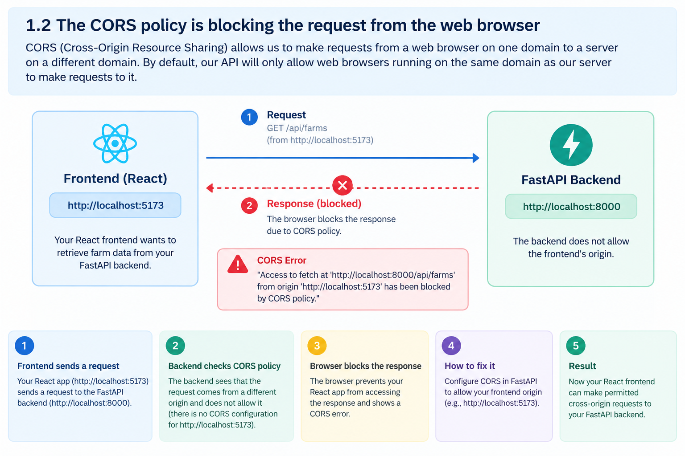
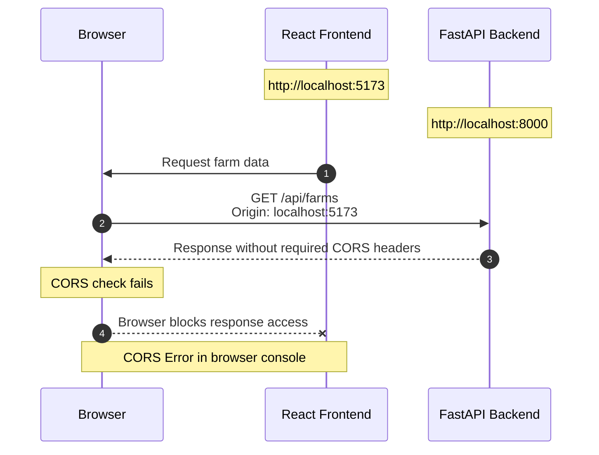

# Handle request from web browser

Now we are using our API from the `Postman`. But in this section, we will handle request from the `web browser`.

1. [Access API using the `web browser`](#1-access-api-using-the-web-browser)
2. [The CORS policy is blocking the request from the `web browser`](#2-the-cors-policy-is-blocking-the-request-from-the-web-browser)
3. [Fix the CORS policy issue](#3-fix-the-cors-policy-issue)
4. [Resources](#4-resources)

## 1. Access API using the `web browser`

From the browser go to `Right click` and select `Inspect` to open the `Developer Tools` then go to `Console` tab. Try to send a request to the API using the `fetch` method.

```javascript
fetch("http://127.0.0.1:8000/posts")
  .then((res) => res.json())
  .then(console.log);
```

This will give us an error.

```plaintext
Access to fetch at 'http://127.0.0.1:8000/posts' from origin 'https://www.google.com' has been blocked by CORS policy: No 'Access-Control-Allow-Origin' header is present on the requested resource.
VM797:1  GET http://127.0.0.1:8000/posts net::ERR_FAILED 307 (Temporary Redirect)
```

If we try to access the endpoint `http://127.0.0.1:8000/posts` from the `postman`, we will get the response as follows:

```json
{
  "message": "Hello World"
}
```

## 2. The CORS policy is blocking the request from the `web browser`

CORS (Cross-Origin Resource Sharing) allows us to make requests from a `web browser` on one domain to a server on a different domain. By default, our API will only allow web browsers running on the same domain as our server to make requests to it.

**Example**:

Suppose you are developing your Farm Management System.

- Frontend (React): `http://localhost:5173`
- Backend (FastAPI): `http://localhost:8000`

Your React frontend wants to retrieve farm data from your FastAPI backend.

Because the frontend and backend use different ports, the browser treats them as different origins.

If the backend does not allow the frontend’s origin, the browser may block React from accessing the response. This is called a CORS error.



**Sequence Diagram**:



## 3. Fix the CORS policy issue

To fix the CORS policy issue, we need to add the `Access-Control-Allow-Origin` header to the response. Need to update the `main.py` file.

```python
# app/main.py
from fastapi import FastAPI

from . import models
from .database import engine
from .routers import user, post, auth, vote
from fastapi.middleware.cors import CORSMiddleware

# Create all database tables on startup
models.Base.metadata.create_all(bind=engine)

app = FastAPI()

origins = [
    "https://www.google.com",
]

app.add_middleware(
    CORSMiddleware,
    allow_origins=origins,
    allow_credentials=True,
    allow_methods=["*"],
    allow_headers=["*"],
)

# Include the routers in the main file
app.include_router(user.router)
app.include_router(post.router)
app.include_router(auth.router)
app.include_router(vote.router)
```

Now we can access the API from the `web browser`. Go to `http://google.com` from the browser, right click and select `Inspect` to open the `Developer Tools` then go to `Console` tab. Try to send a request to the API using the `fetch` method.

```javascript
fetch("http://127.0.0.1:8000/posts")
  .then((res) => res.json())
  .then(console.log);
```

This will give us the response as follows:

```json
{
  "message": "Hello World"
}
```

If I go to a different domain and try to access the API using the `fetch` method, I will get the same error.

```javascript
fetch("http://127.0.0.1:8000/posts")
  .then((res) => res.json())
  .then(console.log);
```

This will give us the same error. Because in our `origins` list, we have only `https://www.google.com`. To fix this, we need to add `*` to the `origins` list. But this is not a good practice. We should only allow the origins that we trust.

```python
# app/main.py
origins = ["*"] # Allow all origins

app.add_middleware(
    CORSMiddleware,
    allow_origins=origins, # Allow all origins
    allow_credentials=True,
    allow_methods=["*"], # Allow all methods
    allow_headers=["*"], # Allow all headers
)
```

## 4. Resources

- [FastAPI CORS Tutorial](https://fastapi.tiangolo.com/tutorial/cors/?h=cross#use-corsmiddleware)
